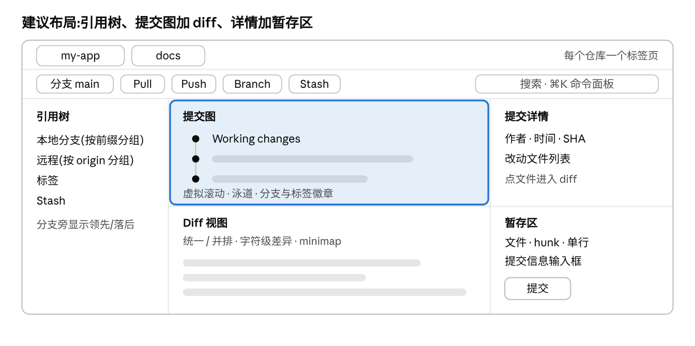

# Gitlane

用 Rust 和 [GPUI](https://gpui.rs) 写的 macOS Git 图形客户端,个人自用。核心体验:大仓库下流畅的提交图、行级暂存、所有写操作可撤销。
不做账号、云同步和任何在线服务;fetch / pull / push 直接走系统 git 与钥匙串。



## 当前能力

- 多仓库标签,文件变化自动刷新;扫描目录批量添加仓库
- 提交图:分支泳道、分支 / 标签徽章、虚拟滚动、按信息 / 作者 / SHA 搜索
- 提交详情;统一 / 并排 diff,字符级差异,minimap
- 文件、hunk、单行三级暂存与取消暂存;丢弃改动;提交与 amend
- 分支创建 / 切换 / 重命名 / 删除(按前缀分组),fetch / pull / push / force push
- stash、reset(soft / mixed / hard)、cherry-pick、revert、merge、标签
- 撤销与重做:commit、checkout、discard、删除分支、reset 等(⌘Z / ⌘⇧Z)
- 命令面板(⌘K),亮色 / 暗色主题(⌘⇧T)

尚未完成的部分(交互式 rebase、三方冲突编辑器、blame、reflog 等)见 [docs/roadmap.md](docs/roadmap.md)。

## 构建与运行

需要 macOS 13+、Xcode 与命令行工具。Rust 版本由 `rust-toolchain.toml` 固定。

```sh
scripts/dev-restart.sh                  # 构建并(重新)启动开发实例
cargo run -p ui -- ~/code/some-repo     # 开发运行
cargo test --workspace                  # 全部测试
./scripts/bundle.sh                     # 生成 dist/Gitlane.app(--dmg 另生成安装包)
./scripts/publish.sh                    # 发版:打 tag、推送、创建 GitHub Release,应用内自动更新
cp -R dist/Gitlane.app /Applications/
```

## 快捷键

| 快捷键 | 动作 | 快捷键 | 动作 |
|---|---|---|---|
| ⌘K | 命令面板 | ⌘O / ⌘⇧O | 打开仓库 / 扫描目录 |
| ⌘↵ | 提交 | ⌘L | 聚焦提交信息 |
| ⌘Z / ⌘⇧Z | 撤销 / 重做操作 | ⌘F | 搜索提交 |
| ⌘⇧F / ⌘⇧L / ⌘⇧K | Fetch / Pull / Push | ⌘⇧B | 新建分支 |
| ⌘⇧A / ⌘⇧U | 暂存全部 / 取消暂存全部 | ⌘⇧S | Stash |
| ⌘\\ | 统一 / 并排 diff | ⌘⇧T | 切换主题 |
| ↑↓ 或 j/k | 在提交图中移动 | ⌃⇥ | 下一个标签 |

diff 中点击改动行可以选中,Shift 点击连选,然后“暂存选中的 N 行”。

## 文档

| 文档 | 内容 |
|---|---|
| [docs/plan.md](docs/plan.md) | 原始开发方案(需求来源) |
| [docs/roadmap.md](docs/roadmap.md) | 排期与逐项进度 |
| [docs/architecture.md](docs/architecture.md) | 分层、crate 职责、线程模型、撤销设计、性能数据 |
| [docs/development.md](docs/development.md) | 环境、命令、扩展方式、GPUI 踩坑记录 |
| [docs/testing.md](docs/testing.md) | 自动化测试矩阵、实测数据、手工回归清单 |
| [docs/decisions/](docs/decisions/) | 架构决策记录 |
