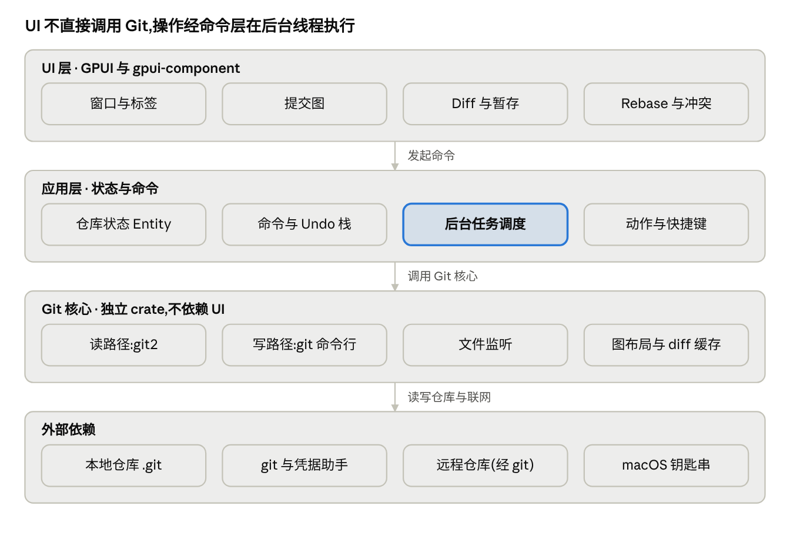

# 技术架构

本文描述代码的实际结构。需求与取舍见 [plan.md](plan.md),进度见 [roadmap.md](roadmap.md)。



## 分层与 crate

同一个 Cargo workspace,依赖方向自上而下,下层不知道上层的存在:

| crate | 职责 | 依赖 GPUI | 测试方式 |
|---|---|---|---|
| `crates/ui`(二进制 `gitlane`) | 全部 GPUI 视图、动作与快捷键、对话框、命令面板 | 是 | `#[gpui::test]` 无头窗口集成测试 |
| `crates/app` | 仓库状态 Entity、命令排队与后台执行、撤销栈、文件监听防抖、设置 | 是(Entity / Task) | 命令层用临时仓库单测 |
| `crates/graph` | 提交图泳道布局,纯函数 | 否 | 单测 + 基准 |
| `crates/gitcore` | 仓库读写、diff、部分补丁、撤销快照、文件监听 | 否 | 临时仓库集成测试 |

### gitcore

| 模块 | 内容 |
|---|---|
| `repo.rs` | **读路径**(git2):`history`(拓扑+时间排序,附父提交行号)、`refs`(分支/远程/标签/stash,领先落后)、`status`、`commit_detail` |
| `diff.rs` | 单文件 diff(提交 / 已暂存 / 未暂存)、显示用的全文 diff(`display_diff`)、大文件保护(`LARGE_DIFF_LINES`)、删除块与新增块配对、字符级差异(`similar`) |
| `highlight.rs` | 源码语法高亮(syntect):`highlight_source` 按路径给一段文本(hunk 的一侧)算高亮,只输出 `keyword` / `string` 这类高亮名,颜色由 ui 的 `colors.rs` 决定 |
| `patch.rs` | 从 hunk 中挑选部分行生成补丁,支持暂存 / 取消暂存 / 丢弃三个方向 |
| `config.rs` | 全局 git 配置(`~/.gitconfig`)的读写:身份、pull 方式、提交签名、默认分支名;读写都走系统 `git config`,测试用 `--file` 指向临时文件 |
| `cli.rs` | **写路径**:调用系统 `git`,`GIT_TERMINAL_PROMPT=0`、`GIT_EDITOR=true`,支持 stdin 与取消(结束子进程) |
| `ops.rs` | 写操作的薄封装:stage/unstage/apply/discard/commit/checkout/branch/fetch/pull/push/stash/reset/cherry-pick/revert/tag/merge/abort |
| `undo.rs` | 引用快照(含上游配置)与文件快照、`record_refs` / `record_files` / `record_stash_drop`、`undo` / `redo`、`UndoStack` |
| `watch.rs` | `notify` 递归监听工作区,区分工作区变化与 `.git` 内变化,忽略 objects/logs/lock |

### graph

输入:按拓扑顺序排列的提交、父提交行号;输出:每行的节点列与线段(上半段 / 下半段 / 贯穿)。

- 第一个父提交总是沿用节点所在列,主线保持竖直、不随合并漂移;
- 其余父提交优先连到已有泳道,否则在节点右侧开新泳道;
- 空出的列会被后续分支复用,泳道不平移,滚动时线条不会左右跳;
- 线段按行连续存放在一个 `Vec` 里(`row_offsets` 索引),5 万行只有两次大分配。

`GraphBuilder::push` 支持增量布局,将来可以边读历史边布局。

### app

- `command.rs`:所有写操作统一为 `Command` 枚举,`execute(path, cmd, cancel)` 在后台线程同步执行,
  按命令类型决定是否生成撤销记录、用哪种 reset 方式撤销。**不依赖 GPUI**,可直接测试。
- `repo_model.rs`:`RepoModel` Entity,视图读取的全部状态都在这里:
  - `data`(历史 + 图 + 引用,`Arc` 整体替换)、`status`、`selection`、`detail`、`diff`;
  - 命令队列:同一仓库的命令串行执行,失败后清空队列,避免连锁错误;
  - 全量加载与 status 加载各自单飞:进行中再请求只记“待刷新”,结束后补跑一次;
  - 代数计数(`detail_gen` / `diff_gen`):过期的详情与 diff 结果直接丢弃;
  - diff 分两步加载:先算 diff,再在另一个后台任务里算语法高亮(大文件要几百毫秒)。首次打开先显示无高亮的 diff;
    刷新(文件被改动)时保留旧内容,等高亮算完一起替换,避免闪烁;
  - 文件监听:`notify` 线程 → `futures` 通道 → 前台任务,防抖 300 ms 后刷新;只有 HEAD / refs / 进行中操作的变化才全量重载,
    `.git/index` 等只刷新 status(编辑器后台 `git status` 会频繁刷新 index);命令执行期间忽略自身写入引起的事件;
  - 通过 `RepoEvent` 通知视图显示提示、清空提交框。
- `workspace.rs`:多仓库标签、设置读写(`update_settings` 改完立即保存,并把提交上限、diff 上下文行数同步到已打开的仓库)、
  启动时检测 git 版本、自动 fetch 定时器(每分钟检查一次,到期且空闲的仓库静默 fetch,成功不提示、失败只记日志)、
  全局 git 配置的后台读写(`load_git_config` / `set_git_config`,界面先按新值显示,写入失败时显示错误并重新读取)。
  `Workspace::new(settings, ephemeral)` 的 ephemeral 模式不写设置、不监听文件、不启动自动 fetch、不碰全局 git 配置,供测试使用。

### ui

| 文件 | 区域 |
|---|---|
| `root.rs` | 窗口根:仓库标签栏、欢迎页、全局动作(打开/关闭标签、⌘W 关闭窗口、主题、命令面板) |
| `repo_view.rs` | 单仓库视图骨架:工具栏、进行中操作横幅、状态栏、仓库级动作处理 |
| `sidebar.rs` | 引用树(按前缀分组)、右键菜单 |
| `graph_view.rs` + `graph_canvas.rs` | 提交图:`uniform_list` 虚拟滚动,每行一个 canvas 画线段与节点 |
| `diff_view.rs` | diff 头部工具条,把 `FileDiff` 喂给 gpui-component 的 `Diff` 组件(并排 / 统一、拖选、滚动由组件负责),hunk 按钮 |
| `diff_stage.rs` | 组件选中的行范围换算成 (hunk, 行)、暂存 / 丢弃命令、复制、语法高亮接线 |
| `side_panel.rs` | 提交详情、暂存区、提交框 |
| `dialogs.rs` / `palette.rs` | 确认与输入对话框、命令面板 |
| `settings_ai.rs` / `commit_ai.rs` | 设置的“AI”页;提交框 ✦ 生成提交信息(后台读改动 + 调模型,结果填进输入框) |
| `settings_view.rs` | 设置窗口(独立窗口,用 gpui-component 的 `setting::Settings`);只调用 `Workspace` 的方法,不直接调 git |
| `app_icon.rs` | Dock 图标随主题切换(objc2 调 `NSApplication::setApplicationIconImage`) |
| `actions.rs` | 动作、快捷键、命令面板条目 |

## 线程模型

```
UI 线程(GPUI 前台执行器)            后台执行器(线程池)
──────────────────────────           ─────────────────────────
视图 render ← RepoModel 状态
点击 → RepoModel::run(cmd) ──────→  command::execute:打开仓库、git CLI、撤销快照
                                     load_full:history + graph::layout + refs + status
RepoModel 更新 + cx.notify() ←────   结果(带代数,过期丢弃)
```

- UI 线程不做任何 git 调用,也不做布局计算;
- git2 的 `Repository` 不是 `Sync`,每个后台任务各自 `Repo::open` 一份(很便宜);
- GPUI 自带与平台事件循环集成的异步执行器,没有另起 tokio 之类的运行时。

## 读写分路

见 [decisions/0001-read-write-split.md](decisions/0001-read-write-split.md)。简述:读用 git2(进程内、快),写用系统 git(与用户的配置、凭据助手、hooks、签名完全一致)。

## 撤销

见 [decisions/0003-undo-snapshots.md](decisions/0003-undo-snapshots.md)。

| 操作 | 快照 | 撤销方式 |
|---|---|---|
| commit / amend | 引用 | `reset --soft`,改动回到暂存区 |
| checkout / 新建 / 重命名 / 删除分支、标签 | 引用 | 恢复引用与 HEAD,必要时 checkout |
| reset soft / mixed | 引用 | 按原方式 reset 回去 |
| reset hard | 引用 + `git stash create` | `reset --hard` 回去后重新应用 stash 提交 |
| cherry-pick / revert / merge / pull | 引用 | `reset --keep`(保留不冲突的本地改动) |
| 丢弃文件 / 丢弃 hunk 或行 | 文件内容(原始字节 + 可执行位)写入对象库 | 写回文件内容 |
| 删除 stash | stash 提交与描述 | `git stash store` 放回 |

恢复只动记录前后不同的引用 / HEAD / 上游配置 / 文件,并先核对它们仍处于操作后的状态,
之后被别处改过就报错不动(细节见 0003)。撤销栈每个仓库一个,只在内存中,上限 100 条。

## 性能数据

| 项目 | 结果 | 条件 |
|---|---|---|
| 泳道布局 5 万提交 | 1.9 ms | `cargo run -p graph --release --example bench_layout` |
| 打开 52,499 提交的仓库(历史 + 布局 + 引用 + status) | 480–880 ms | 其中 history 约 590 ms、refs 约 90 ms |
| 内存 | 小仓库 118 MB;5 万提交 248 MB | release,稳定后 RSS |

更多数据与测量方法见 [testing.md](testing.md)。
