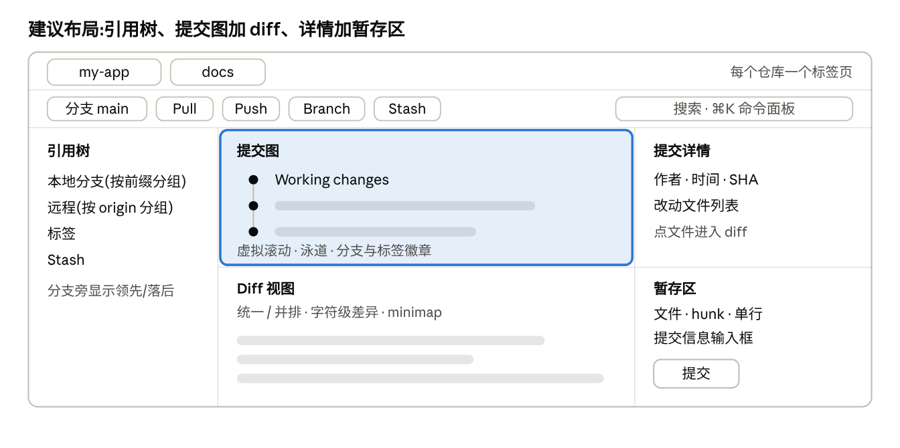
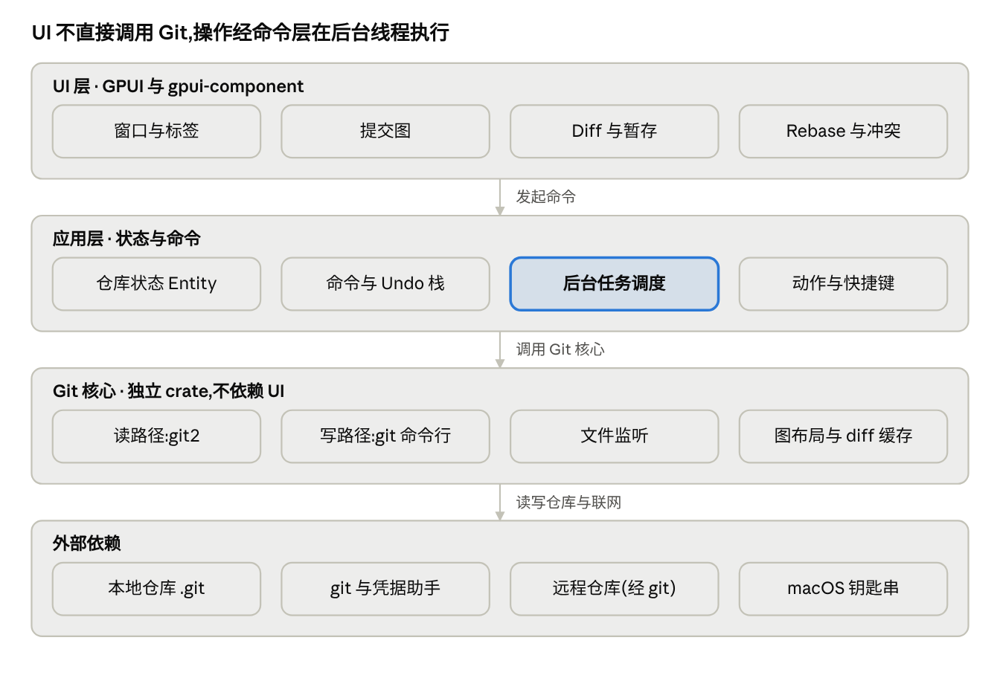

> 本文件由原始方案《GPUI Git 客户端开发方案.docx》转换而来,是项目的需求来源。实现进度见 [roadmap.md](roadmap.md)。

# GPUI Git 客户端开发方案

Nov 4, 2026 · @Lee

## 项目定位与目标

用 Rust 和 GPUI 做一款只在 macOS 上运行、个人使用的 Git 图形客户端,一次交付。核心体验参考 Gitoryx:大仓库下依然流畅的提交图、拖拽式交互 rebase、行级暂存、内置三方冲突合并。

- 使用者:我自己。不做账号、云同步、付费和任何在线服务;fetch、pull、push 直接走系统 git。
- 平台:仅 macOS,Windows 不做,Linux 随后也不做。
- 取舍:不做公证、崩溃上报;自己构建、自己使用。应用内更新后来补上,见 [decisions/0006](decisions/0006-self-update.md)。

成功标准(均为建议目标,原型完成后用实测数据校准):

- 冷启动到可操作:1 秒以内。
- 提交图:5 万个提交的仓库,滚动保持 60 fps。
- stage、commit、切换分支等常用操作:界面响应 100 毫秒内,耗时操作不阻塞界面。
- 空闲内存:150 MB 以内(第三方介绍称 Electron 类客户端空闲时约 300–500 MB)。

## 参考产品分析

Gitoryx 把“可以直接操作的提交图”放在产品中心:一个窗口、多仓库标签,所有写操作都带撤销。以下依据官网首页的在线演示和功能说明整理,我没有看到桌面版的实机界面。

技术栈(重要):Gitoryx 在对比页里写明自己是单一的 Tauri 2 代码库,官网 FAQ 说 Linux 版使用 WebKitGTK。也就是说它的“原生”指不带 Electron,界面仍然是系统 WebView。用 GPUI 并不是复刻它的实现:换来的是 GPU 自绘的更高性能上限,代价是 WebView 里现成的 diff 高亮、虚拟列表、富文本等能力要自己实现或另找替代。

界面布局(来自官网在线演示)

- 顶部:仓库标签页、当前分支、Pull、Push、Branch、Stash 按钮、搜索框。
- 左侧栏:Local 分支(带领先/落后箭头,按 feature、fix 等前缀分组成树)、Remote(按 origin 分组)、Stashes、Refs。
- 中央:提交图,每行是分支泳道、作者头像和提交信息;最上方是 Working changes 行。
- 另有提交详情面板(演示中标为 Details)。

交互特点

- 主线只有三步:点图中的提交看详情,打开改动文件看 diff,在 Working changes 里暂存并提交。
- 拖拽是核心手势:交互式 rebase 的重排、squash、edit、drop 都靠拖拽,分支操作也支持拖拽。
- 每步可撤销:checkout、commit、discard、删除分支、移除 remote、reset 分支都能一键撤销和重做(对比页称 1-click undo/redo)。
- Diff 提供统一和并排两种视图,支持字符级差异、minimap、逐行暂存。
- 冲突解决是内置的三方并排编辑器,支持行内编辑和字符级高亮(对比页)。
- 命令面板(⌘K)和快捷键,亮色与暗色主题。
- 动作按真实 Git 操作命名,方便边用边学;命令行里的改动会实时反映到界面(对比页)。

## 功能范围

一次交付全部功能。清单对照 Gitoryx 官网和对比页列出的能力,去掉所有需要联网服务的部分。内部按依赖顺序实现,顺序见“排期”。

| 模块 | 功能 |
|---|---|
| 仓库与刷新 | 多仓库标签、打开本地仓库、文件监听实时刷新 |
| 提交图 | 分支泳道、分支与标签徽章、虚拟滚动、按信息/作者/SHA 搜索 |
| 提交详情与 diff | 统一和并排视图、语法高亮、字符级差异、minimap |
| 暂存与提交 | 文件、hunk、单行三级暂存;提交信息输入;提交签名(可选) |
| 分支与同步 | 创建、切换、重命名、删除、树状分组;fetch、pull、push(走系统 git 与钥匙串) |
| 交互式 rebase | 拖拽重排、squash、fixup、edit、drop,执行前预览结果 |
| 冲突编辑器 | 内置三方编辑器,字符级高亮 |
| 撤销与重做 | checkout、commit、discard、删除分支、reset 等操作一键撤销 |
| 常用 Git 能力 | stash、reset(soft/mixed/hard)、cherry-pick、revert、tag |
| 排障与历史 | blame、文件历史、reflog、bisect 界面、worktrees |
| 效率 | 命令面板、快捷键、亮色与暗色主题 |

不做:应用内 PR 管理、AI 提交信息、Gitmoji、GitFlow、changelog 生成、sprint 看板、账号体系、任何在线服务,以及 Windows 与 Linux。其中 Gitmoji、GitFlow、changelog 日后需要时可以再加。

## UI 设计与交互方案

主窗口采用“左侧引用树 + 中间提交图与 diff + 右侧详情与暂存区”的结构,所有操作围绕图展开。这是参考 Gitoryx 在线演示的布局做的建议版本,不是复刻。

主窗口建议布局 · 三栏

左栏放引用;中间上图下 diff;右栏上方是提交详情,下方是暂存区与提交框。提交图是视觉重心。

核心界面

- 提交图:固定行高,只渲染可见行;泳道布局在后台线程增量计算并缓存,滚动时 UI 线程只读结果。点击一行,右侧显示详情;最上方固定一行 Working changes。
- 暂存区:未暂存与已暂存两栏,文件按目录折叠;支持文件、hunk、单行三级暂存,可拖选多行。
- Diff:统一与并排切换、字符级差异、minimap。超大文件只显示摘要并提供“仍然显示”,避免卡死。
- Rebase 界面:一行一个提交,拖拽重排,行内下拉选择 pick、squash、fixup、edit、drop;执行前预览结果,执行后可一键撤销。
- 冲突编辑器:左右为双方版本,下方为可编辑的合并结果,冲突块逐个接受或手改,字符级高亮。

交互原则

- 撤销优先:所有写操作统一走命令层,执行前记录相关 ref 位置和必要的工作区快照,撤销时恢复。
- 不阻塞:UI 线程只负责渲染;Git 操作在后台执行,显示进度并可取消。
- 键盘优先:命令面板支持模糊搜索全部动作,菜单项都有快捷键。
- 危险操作要明说:force push、hard reset、丢弃改动之前,列出将受影响的提交或文件。
- 实时但不抖动:监听文件变化,防抖后再刷新,避免外部工具大量写文件时界面闪烁。
- 主题与设计 token:颜色、间距、字号统一成 token,亮色和暗色共用一套组件。

中文与输入法:提交信息框、搜索框、分支重命名框都要验证输入法组合输入(候选框位置、组合态、选词上屏)。GPUI 在这方面的表现要在原型阶段实测,结果会影响是否自己实现文本输入组件。

## 技术架构

分三层:GPUI 视图层、应用层(状态与命令)、独立的 Git 核心 crate。核心原则是 UI 线程只做渲染,Git 读写分路:读用进程内库,写调用系统 git,以保证和用户已有的配置、凭据、hooks、签名完全一致。

分层架构 · 四层

视图只订阅状态、只发命令;Git 调用经后台任务调度执行,结果写回 Entity 后视图自动重绘。

Git 引擎选型

| 方案 | 优点 | 缺点 | 本项目用法 |
|---|---|---|---|
| git2(libgit2 绑定) | 进程内调用,核心成熟,不依赖 git 程序 | 是对 git 行为的重新实现,和命令行有细微差异 | 读路径:log、status、diff、引用 |
| gitoxide(gix) | 纯 Rust,进程内,性能目标高 | 完整 status、commit、merge、rebase 仍在开发中 | 暂不作为主力,主线功能完成后再评估替换读路径 |
| 系统 git 命令行 | 与用户的 git 完全一致,天然复用凭据助手、签名、hooks | 每次操作要启动进程并解析输出,用户需安装 git | 写路径:commit、rebase、merge、pull、push |

并发模型:应用状态放在 GPUI 的 Entity 里;Git 操作提交到后台执行器,完成后更新 Entity,视图自动重绘。GPUI 自带与平台事件循环集成的异步执行器,不需要另起运行时(原型阶段确认)。

模块划分(同一个 Cargo workspace)

- gitcore:仓库读写、命令、撤销记录。不依赖 GPUI,可独立测试。
- graph:提交图泳道布局算法,纯函数,方便做性能基准。
- app:仓库状态、命令分发、任务调度、设置。
- ui:全部 GPUI 视图。基础控件用 gpui-component,提交图、diff、rebase 列表用自定义元素。

GPUI 的使用约束

- GPUI 仍在随 Zed 开发,没有 1.0,版本之间常有破坏性更新。依赖固定到具体版本或提交,升级单独排期。
- 平台依赖:macOS 用 Metal 渲染,需要 Xcode 与命令行工具,命令行工具里自带 git。
- 测试:gitcore 用临时仓库做集成测试;视图和状态用 GPUI 自带的测试宏和测试上下文。
- 文档少,遇到问题主要靠读 Zed 源码和社区。

## 排期(一次交付)

按 1 人全职开发估算(假设),约 5 个月一次交付;业余时间开发则按比例延长。内部按依赖顺序推进,中途不单独发版。

实现顺序与验收

- 技术验证(约 2 周):用 GPUI 做提交图加 diff 的最小原型,拿提交很多的真实仓库测。验收:滚动流畅,中文输入法可用。不达标就重新比较方案,不往下做。
- 主线功能(约 6 周):仓库与标签、提交图、diff、暂存与提交、分支管理、fetch/pull/push。验收:能替代自己日常的提交与同步操作。
- 差异化功能(约 7 周):交互式 rebase、冲突编辑器、撤销与重做。验收:常见的 rebase 与冲突场景能完成,且能撤销。
- 其余 Git 能力(约 4 周):stash、reset、cherry-pick、revert、tag、blame、reflog、bisect、worktrees、命令面板。
- 打磨与打包(约 3 周):性能收尾,中文输入与高分屏回归,本机打成 .app。

## 风险与对策、测试与发布

最大的风险是 GPUI 本身:没有 1.0、文档少、中文输入法需要实测。所以第 1 步先验证最难的几件事,再决定是否继续。

| 风险 | 影响 | 对策 |
|---|---|---|
| GPUI 没有 1.0,版本间有破坏性更新 | 升级成本不可预期 | 固定依赖版本,变动隔离在 ui crate,升级单独排期 |
| 中文输入法、文本输入组件不完善 | 提交信息和搜索框无法正常输入 | 第 1 步首要验证;不行就自己实现文本输入,或回头评估 Tauri |
| 文档少、社区小 | 排障慢 | 读 Zed 源码,第 1 步预留学习时间 |
| 大仓库下读路径慢 | 提交图与 status 卡顿 | 后台线程加缓存,graph 做基准测试,必要时评估 gix |
| 写路径依赖系统 git | git 版本过旧时行为不一致 | 启动时检测版本并提示 |
| 撤销实现复杂,可能丢数据 | 数据安全 | 执行前快照,每类操作单独写测试,高风险操作二次确认 |

测试:gitcore 用临时仓库做集成测试,覆盖 rebase、冲突和撤销;graph 做基准测试;视图用 GPUI 的测试宏;每个版本跑一份手工回归清单(中文输入、高分屏、大仓库)。

交付:在本机用 cargo build --release 打成 .app 自用;不做签名公证、自动更新和崩溃上报。

## 来源

官网页面于 2026-11-04 读取;没有看到桌面版实机界面,布局与交互按在线演示和文字说明整理。

- Gitoryx 官网首页
- Gitoryx vs Fork
- Gitoryx vs GitHub Desktop
- Gitoryx vs Git Cola
- Gitoryx 介绍(PeerPush)
- GPUI 文档(docs.rs)
- gpui-component
- gitoxide 与 git2、命令行的对比
- gitoxide 功能现状
